<div align="center">


# caret

**A terminal emulator written from scratch in Rust.**
Native tmux-style splits, 56 themes, a file explorer, an agent dock,
and a window that rasterises every glyph itself.

[](https://github.com/joelorzet/caret/actions/workflows/ci.yml)
[](LICENSE)
[](https://www.rust-lang.org)
[](#development)
[](docs/platforms.md)

</div>

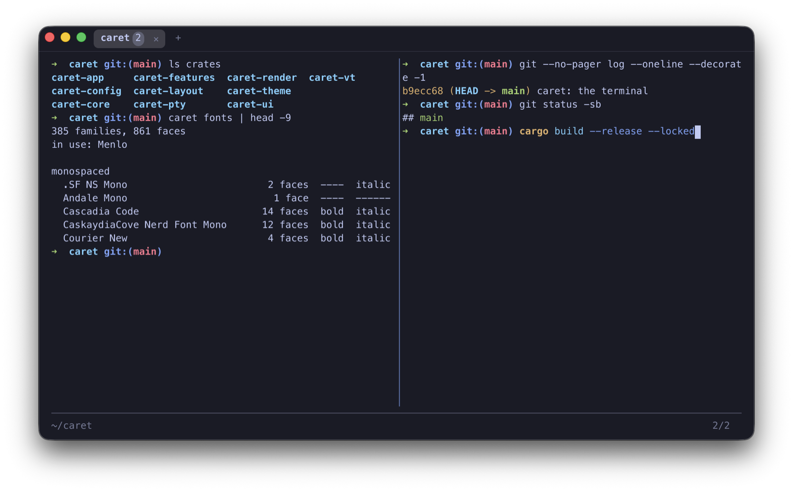

## What it is

caret is a terminal emulator and a multiplexer in one program. The splits, the
tabs, the layouts and the scrollback are the terminal's own, so there is no
second process between you and the shell, no nested escape sequences, and one
pseudoterminal per pane rather than one per program.

It is built out of ten crates with a hard rule about dependencies: the two that
hold the terminal grid and the pane geometry have none at all, which is what
makes them exhaustively testable. Everything that touches the operating system
lives in `caret-pty` and the host loop.

- **Its own grid.** Cells, colours, cursor, selection and search are plain data
  structures with 84 tests over them, not a wrapper around something else.
- **Its own escape parser.** `caret-vt` turns VT sequences into grid edits.
- **Its own renderer.** The window rasterises glyphs with `fontdue`, caches
  them, and blends into a CPU framebuffer. Box drawing characters are drawn
  rather than taken from the font, so borders meet exactly.
- **One event loop.** A single `poll` covers every pane, so twenty shells cost
  twenty child processes and no extra threads.

## What it costs to run

Measured on an idle window, one pane, nothing running:

| | |
|---|---|
| CPU | **0.15% of a core** |
| Memory | **65MB** |
| Panes | one child process each, no extra threads |

The window waits for something to happen rather than waking 125 times a second
to find out that nothing has, and a key or a click wakes it at once, so nothing
feels slower for it. The cursor blinks while the window has the keyboard and
somebody is using it, then holds steady: a blink is an entire frame handed to
the compositor, which is 20ms of work at a full-screen retina size, and one
cell of animation is not worth that all day. The grid is sized for the lines a
pane has actually printed and grows as history fills, so a pane costs about 2MB
until it has earned more, rather than 32MB of scrollback nobody has scrolled
to.

## Install

### A released build

Every tagged version publishes one macOS disk image, universal for Apple
silicon and Intel, and a Linux x86_64 tarball, on the [releases
page](https://github.com/joelorzet/caret/releases), with a `SHA256SUMS` file
beside them. [CHANGELOG.md](CHANGELOG.md) says what is in each one.

### macOS, as an app

```sh
./scripts/bundle-mac.sh --install
```

Builds `caret.app`, copies it into `~/Applications` and tells Spotlight about
it, so typing `caret` in Spotlight opens it. Add `--dmg` for a disk image.
Full notes, including reinstalling and removing, are in
[docs/install.md](docs/install.md).

### From source, as a command

```sh
git clone git@github.com:joelorzet/caret.git
cd caret
cargo install --path .
```

Rust 1.87 or newer. macOS and Linux are supported; Windows needs a ConPTY
backend and currently fails to compile with a message saying so. See
[docs/platforms.md](docs/platforms.md).

### Running it

```sh
caret              # the terminal, in its own window
caret inline       # inside the terminal you are already in, for SSH
```

## First five minutes

| Do this | Press |
|---|---|
| Split left and right | `cmd+d` or `ctrl+b %` |
| Split top and bottom | `cmd+D` or `ctrl+b "` |
| Move between panes | `cmd+option+<arrow>` or `ctrl+b <arrow>` |
| Open a tab | `cmd+t` or `ctrl+b c` |
| Everything caret can do | `cmd+P` or `ctrl+b ?` |
| Settings | `cmd+,` or `ctrl+b s` |
| Themes | `cmd+T` or `ctrl+b T` |

Both styles work everywhere: a `ctrl+b` prefix for muscle memory from tmux, and
direct Cmd shortcuts for the window. Modifier names follow the platform, so a
Mac is told about `option` and `cmd` while Linux is told about `alt` and
`super`.

## Features

### Panes that stay where you put them

Splits are a tree, not a grid. Panes resize with `cmd+ctrl+<arrow>`, zoom to
fill the tab with `cmd+enter`, and even out with `ctrl+b E`. Five layout presets
are bound to `ctrl+b option+1` through `5`, and `ctrl+b space` cycles them.
Applying a layout reuses the panes already open, so rearranging never restarts
a shell.

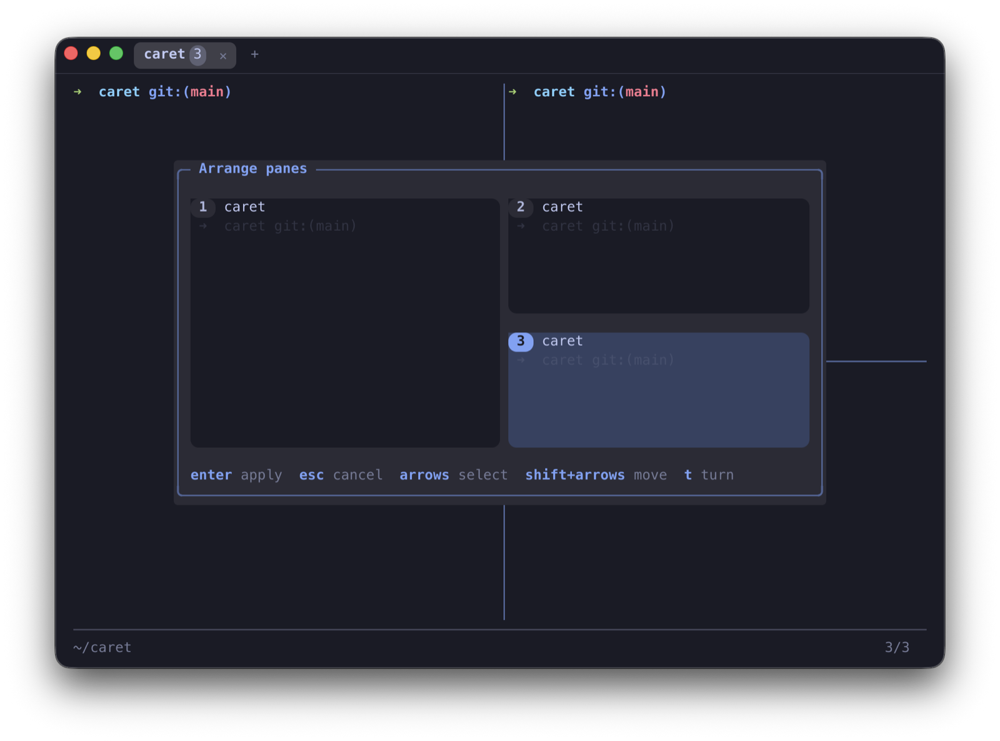

`cmd+option+m` opens the arrange panel: the tab as numbered boxes, each showing
the last few lines its terminal printed so you can tell which is which. Arrows
or `1` to `9` pick a box, shift and an arrow moves it, `t` turns a split, `=`
evens everything up. **Nothing behind the panel moves until you press enter**,
and escape leaves the layout exactly as it was. Each pane keeps its own number
between visits, so pane 2 is still pane 2 next time.

### Tabs that can be named

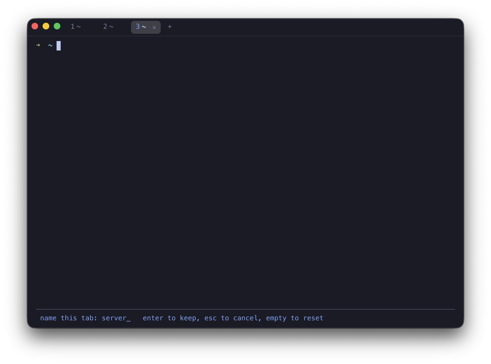

A tab is named after the directory its focused pane is in, and `cmd+R`
renames it. The prompt starts from the current name, so fixing one letter is
not a retype, and an empty name hands the tab back to its directory. A tab on
its own carries no number, since there is nothing to pick it out from; the
numbers come back with the second tab.

### A command palette that also rebinds

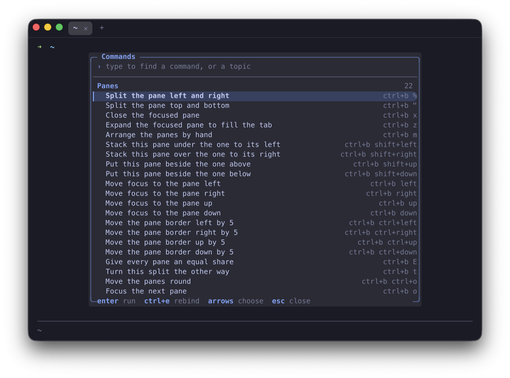

`cmd+P` lists every command under its topic: Panes, Layouts, Tabs, Sidebars,
Scrollback, Clipboard, General. Typing filters on the topic too, so `pane`
narrows the list to the pane commands. **`ctrl+e` on any row rebinds it**: press
the new shortcut and it is written into `[keys.direct]` in your config and
applied at once, leaving the rest of the file as you had it.

### Settings you can see

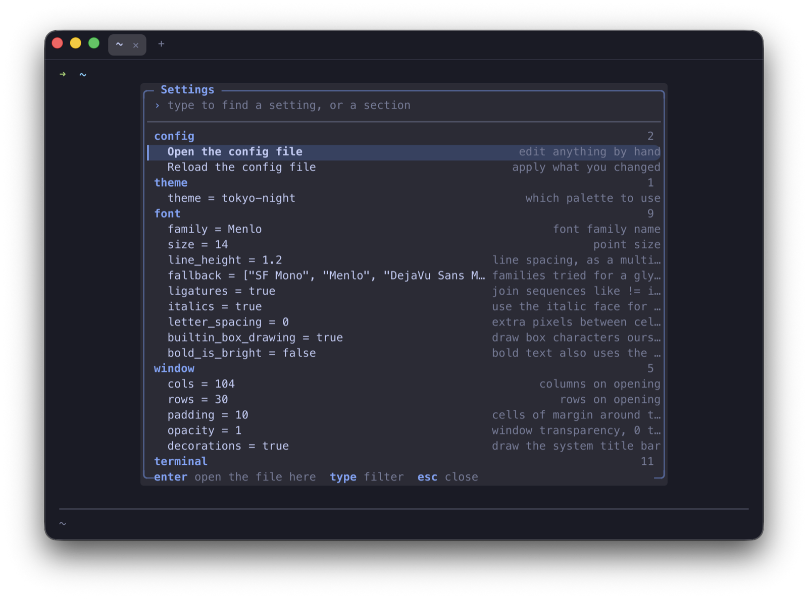

`cmd+,` lists every setting the config file accepts with its section, its
current value and what it does. Enter opens `config.toml` in your editor **on
the setting you were looking at**, writing that setting into the file first so
there is always something to change. `cmd+option+,` goes straight to the file.

### 56 themes, held to a contrast floor

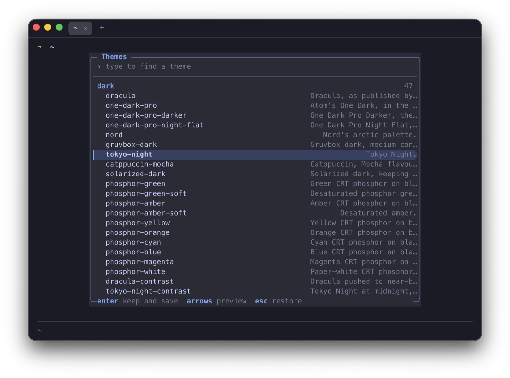

`cmd+T` previews each theme live as you arrow through the list and saves on
enter. Every theme is held to 4.5:1 WCAG contrast for body text by a test, so
one that falls below it does not ship. Window chrome is derived from each
palette, and dividers are solved for a consistent 2.4:1 so they read the same
everywhere.

| | |
|---|---|
| **tokyo-night** | **dracula** |
| 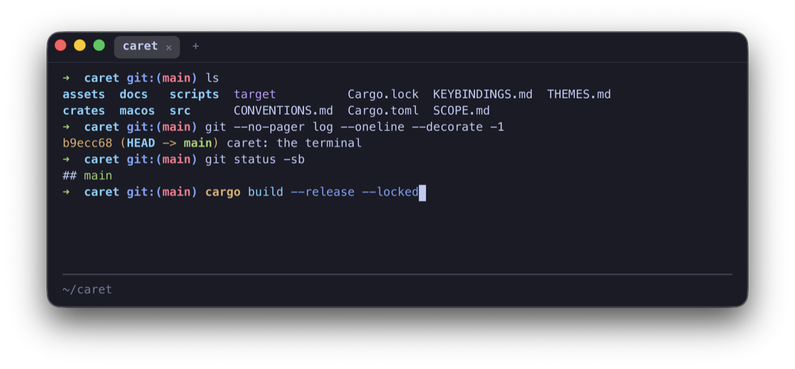 | 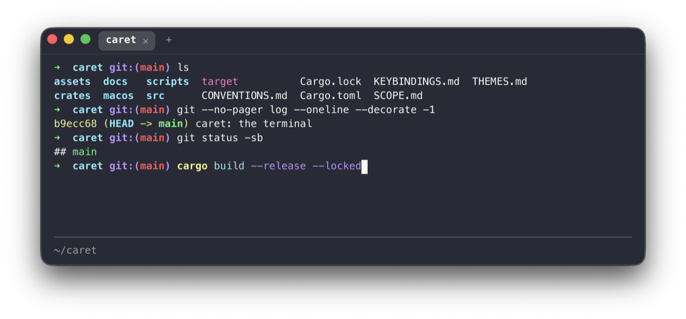 |
| **catppuccin-mocha** | **gruvbox-dark** |
| 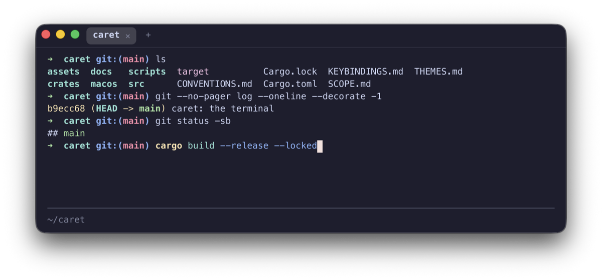 | 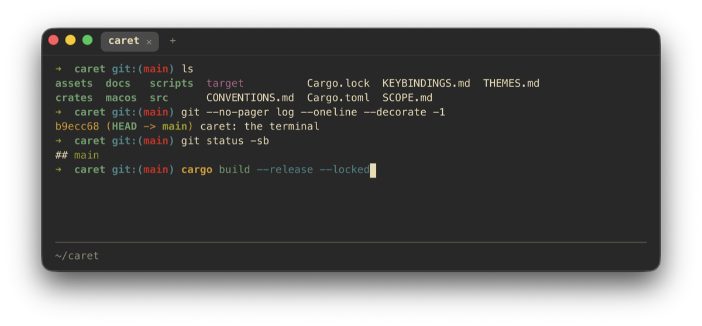 |
| **nord** | **one-dark-pro** |
| 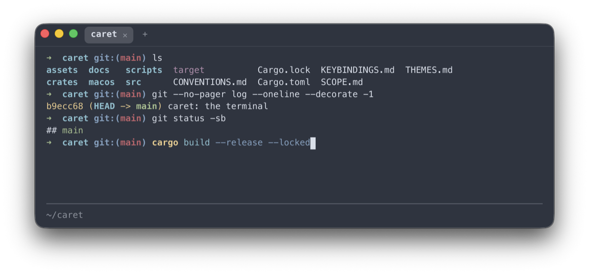 | 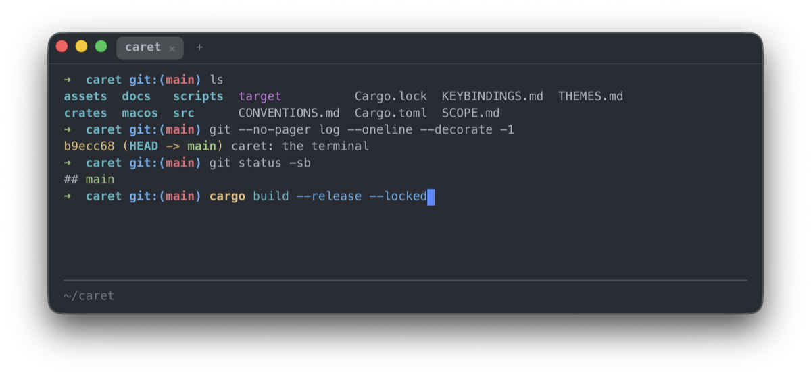 |
| **github-light** | **phosphor-green** |
| 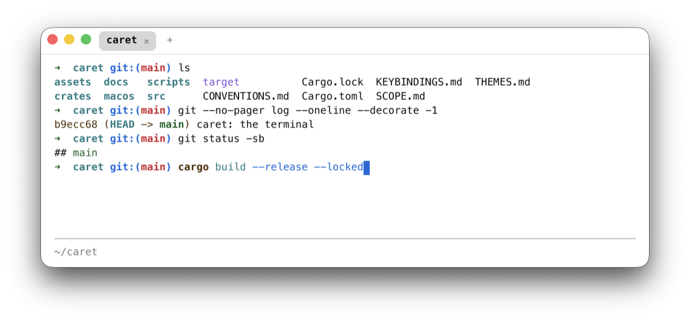 | 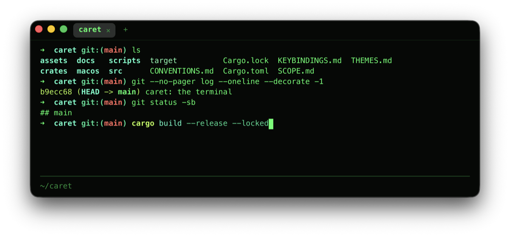 |

47 are dark and 9 are light. Names ending in `-contrast` are deeper cuts of the
theme they are named after; the `phosphor-*` family are single colour CRT
palettes that keep red and yellow so errors and warnings still carry. The full
list, with every contrast ratio, is in [THEMES.md](docs/THEMES.md). Drop a `.toml`
into `~/.config/caret/themes/` to add your own, and it overrides a built-in of
the same name.

### A file explorer, and a reader for what is in it

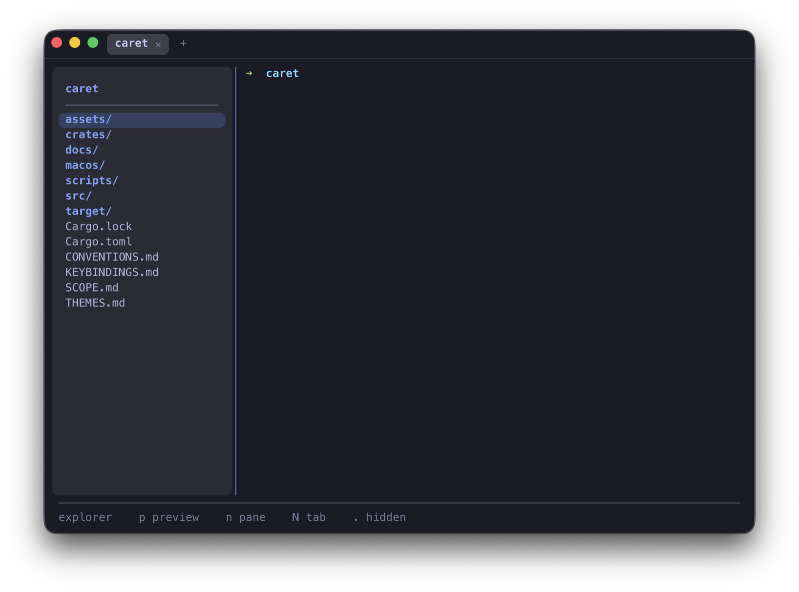

`cmd+b` opens the explorer on the left. It follows the focused pane's working
directory, navigates with arrows, and `.` toggles hidden files. `n` opens a pane
in the folder you are looking at, `N` a tab, and enter on a file types its path
into the shell.

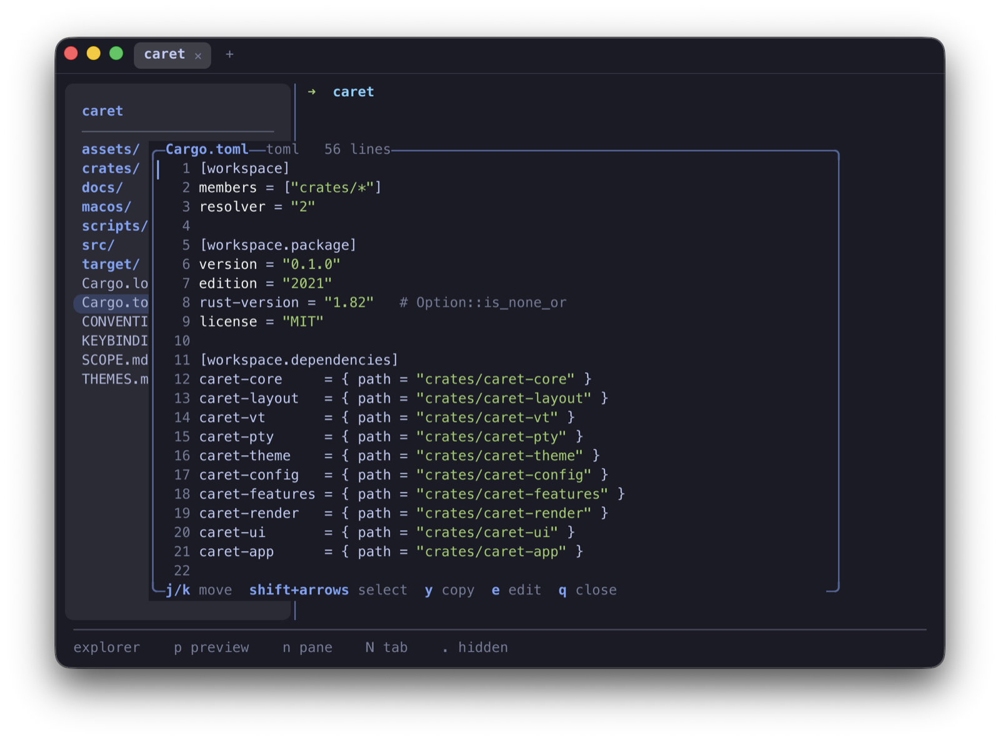

`p` previews a file: syntax coloured, with line numbers, `g` and `G` for the
ends, shift and an arrow to select, `y` to copy and `e` to open it in `$EDITOR`.
Vim and nvim get a real pseudoterminal in a new pane. The colours come from the
active theme's palette, so a deliberately monochrome theme shows code in one
colour.

### An agent dock

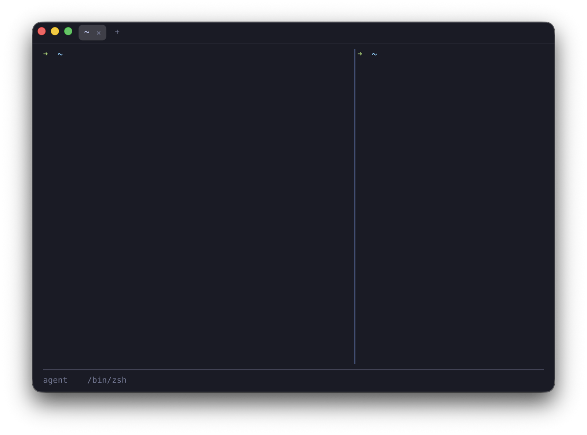

`cmd+j` opens a pane on the right running whatever you set
`sidebar.agent.command` to. It defaults to `claude`; the shot above is a plain
shell, which is all the dock is underneath. It costs one child process and
nothing bespoke.

### Scrollback with search

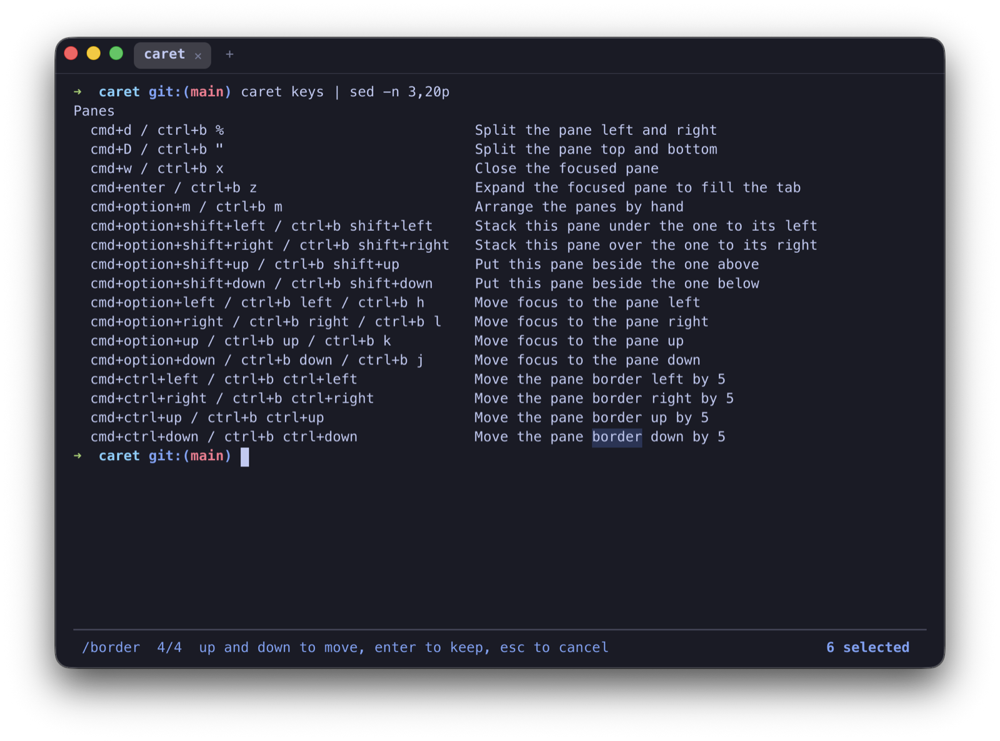

`shift+pageup`, `shift+up` and the wheel move through the scrollback, which is
10,000 lines a pane by default. `ctrl+b /` searches all of it, case insensitive
until you type a capital. Up and down move between matches, and enter keeps the
match selected so `cmd+c` copies it.

### The line you are typing, in colour

The command line is coloured by what each word is: the program, its flags,
quoted strings, paths, variables, numbers and the plumbing between pipeline
stages. **Colour only appears once the command resolves** to something on
`PATH` or a shell builtin, so a lit up line is itself a signal that the thing
will run and a typo stays plain. Aliases and shell functions belong to the
shell, so lines using those read as unrecognised. Turn it off with
`highlight_input = false`.

As you type, the most recent matching command from your history is offered as
ghost text; right accepts it, and down and up choose between matches.

### Moving between commands

When your shell marks where its prompt begins, `cmd+up` and `cmd+down`
scroll to the previous and next command, which is what you want after a
build has printed four hundred lines. A command that fails, or that takes
more than a couple of seconds, says so in the status line: `exit 1 after
12s`.

caret reads the standard marks and asks for nothing: a shell that sends
none behaves exactly as before. Most shell integrations emit them already;
in zsh, a `precmd` that prints `\e]133;A\a` is enough to get the jumps.

### Being told when a long command finishes

A build you started in another pane and then stopped watching finishes
quietly, and you find out about it whenever you next look. When a command
takes longer than `notify_after` seconds, caret says so: in the status line
if you are watching that pane, and as a desktop notification if you are
not, naming the pane, the exit status and how long it took. Switching panes
or away from the window is what decides which one you get, so a command you
sat and watched never raises a notification.

`notify_finish` under `[terminal]` takes `status` to keep it in the status
line always, `system` to allow the desktop notification, or `off`. It needs
the same prompt marks the jumps use.

### Links you can open

A URL in output, or a file path that exists, is something to click: hold
`cmd` (`ctrl` elsewhere) and the link under the pointer underlines itself.
A URL opens in your browser; a file opens in `$EDITOR`, at the line and
column if the text gives them, which is what a compiler error does. A plain
click still places the cursor and selects, and a word that merely looks
like a path is left alone.

A program can also mark text as a link itself, with a target that need not
be the text at all: a build tool offers a clickable test name, `ls
--hyperlink` offers a file whose shown name is not its path. Those are
believed over anything caret works out for itself, since the program knows
what the text means. Because the text can then claim to be anything, the
status line names the target rather than the text as it opens, and only
`http`, `https`, `mailto` and this machine's own `file://` paths are opened
at all.

### Mouse and clipboard

Click focuses a pane or a tab, drag selects, double click takes a word, triple
click a line, and the wheel scrolls. Applications that ask for mouse reports get
them, and holding shift selects anyway. `cmd+c` puts the selection on the system
clipboard with OSC 52, which works over SSH without a platform clipboard
library. Paste is bracketed when the application asked for it.

## Configuration

Everything lives in `~/.config/caret/`:

```
~/.config/caret/
├── config.toml     settings, keybindings and saved layouts
├── themes/         your own themes, one .toml each
├── history         what the suggestions are drawn from
└── update-check    when the last update check ran, and what it found
```

`caret config init` writes a starter file with every setting at its default and
a comment naming the allowed values. A value that is not understood is reported
and ignored: the setting keeps its default and the rest of the file is still
read, so nothing in here can stop the terminal starting. `caret config` prints
what is actually in effect along with anything it could not use.

```toml
theme = "tokyo-night"

[font]
family = "JetBrains Mono"
size = 13.0
ligatures = true           # let the font join != and => into its own glyph
builtin_box_drawing = true # draw box characters ourselves, for seamless borders

[terminal]
scrollback = 10000
cursor = "block"           # block | underline | bar | hollow
confirm_close = true       # ask before closing a pane with a job running
highlight_input = true     # colour the command line as you type it
notify_finish = "system"   # off | status | system
notify_after = 30          # seconds before a command is worth reporting

[sidebar.agent]
command = "claude"         # any program on PATH

[keys]
prefix = "ctrl+b"          # or "none" to turn prefixed bindings off

[keys.direct]
"cmd+ctrl+left" = "resize_left:10"

[layouts.review]
description = "Wide left pane, three narrow ones right"
split = "h(60:*, 40:v(*, *, *))"
```

Saved layouts are either a preset with a pane count or an explicit shape in the
spec language, where `*` is a pane and a split is `h(..)` or `v(..)`. Recall one
with `apply_layout:<name>` bound to a key.

## Keeping it up to date

caret asks once a day whether a newer release has been published, and says so
in the status line when there is one. On demand:

```sh
caret update             # is there a newer release?
caret update --install   # fetch it, check it, put it in place
```

Inside caret, `caret` is always on the path: a pane starts with the running
binary's own directory in front of `PATH`, so an app bundle that installs
nothing on the system still answers `caret update`.

`--install` downloads the build for this machine, checks it against the
published `SHA256SUMS` and refuses to install anything that does not match.
On macOS it replaces the app bundle it is running from, on Linux the binary,
and it says what to do next. The command palette has **Look for a newer
release** and **Install the newer release**, so the whole thing is two key
presses and no typing.

The check sends caret's name and version and nothing else: no identifiers,
nothing about the machine or the person at it, no token and no cookies. It
asks where `releases/latest` redirects to and compares the tag with this
build. Turn it off and caret never touches the network:

```toml
[update]
check = false
```

## Keybindings

The full list is in [KEYBINDINGS.md](docs/KEYBINDINGS.md), generated by
`caret keys`, and the command palette is the same list at your fingertips.
Rebind anything from the palette with `ctrl+e` or by hand in `config.toml`.

```
Panes
  cmd+d / ctrl+b %                  Split the pane left and right
  cmd+D / ctrl+b "                  Split the pane top and bottom
  cmd+w / ctrl+b x                  Close the focused pane
  cmd+enter / ctrl+b z              Expand the focused pane to fill the tab
  cmd+option+m / ctrl+b m           Arrange the panes by hand
  cmd+option+<arrow>                Move focus
  cmd+ctrl+<arrow>                  Move the pane border by 5
  ctrl+b E                          Give every pane an equal share

Tabs
  cmd+t / ctrl+b c                  Open a new tab
  cmd+R / ctrl+b R                  Name this tab
  cmd+1..5 / ctrl+b 1..5            Go to a tab

Sidebars
  cmd+b / ctrl+b e                  File explorer, left
  cmd+j / ctrl+b a                  Agent panel, right

General
  cmd+P / cmd+/ / ctrl+b ?          Command palette
  cmd+T / ctrl+b T                  Themes
  cmd+, / ctrl+b s                  Settings
  ctrl+b r                          Reload the configuration
```

Running inside another terminal with `caret inline`, only the `ctrl+b` bindings
are reachable, because terminals keep Cmd for themselves. The palette hides the
ones that cannot fire.

## Command line

```
caret                      start the terminal in its own window
caret inline               run inside this terminal instead, for SSH
caret keys                 list the keyboard shortcuts
caret themes               preview the built-in themes in colour
caret fonts [query]        list installed fonts, monospaced first
caret config [show|example|init]
                           show settings, print a starter config, or write one
caret update [--install]   see whether a newer release is out, and install it
caret version              this build, also --version and -V
caret layout               print the pane-tree geometry
```

## Architecture

```
caret-core      the grid: cells, colours, cursor, selection, search
caret-layout    the geometry: pane tree, tabs, saved layouts, chrome
caret-vt        escape sequences onto the grid
caret-pty       pseudoterminals, one poll for every pane
caret-theme     the theme model and the 56 built-in palettes
caret-config    actions, keymap, config file, theme registry
caret-render    font discovery, metrics, glyph raster, box drawing
caret-features  the file explorer and the file preview
caret-ui        the tab strip: layout and hit testing
caret-update    whether a newer release has been published
caret-app       the window, the event loop, input, both renderers
```

| Crate | Dependencies | Tests |
|---|---|---|
| `caret-core` | none | 84 |
| `caret-layout` | none | 123 |
| `caret-theme` | `caret-core` | 27 |
| `caret-config` | core, layout, theme, serde, toml | 100 |
| `caret-vt` | `caret-core`, vte | 84 |
| `caret-pty` | libc | 15 |
| `caret-render` | core, theme, fontdb, fontdue | 34 |
| `caret-features` | none | 109 |
| `caret-ui` | none | 20 |
| `caret-update` | none | 19 |
| `caret-app` | all of the above, winit, softbuffer | 63 |

The house rules are written down in [CONVENTIONS.md](docs/CONVENTIONS.md) and worth
reading before a first patch. In short: declarations and code live in separate
folders (`types/`, `enums/`, `impls/`), a file in `impls/` covers one subject
and a long `impl` becomes a folder rather than a trait, tests never sit beside
the code they test, and a literal in a condition gets a name before it gets
committed.

[SCOPE.md](docs/SCOPE.md) records what was asked for and what state each piece is
in. [docs/limitations.md](docs/limitations.md) records what does not work and
why, each one pinned to the file where it bites.

## Development

```sh
cargo build --release
cargo test --workspace          # 659 tests
cargo clippy --workspace --all-targets
```

Two environment variables make the window easier to work on:

```sh
CARET_TRACE=/tmp/caret.log caret          # log actions and spawns
CARET_SNAPSHOT=/tmp/shot.bmp \
CARET_SNAPSHOT_KEYS='cmd+d,cmd+option+m' \
CARET_SNAPSHOT_DELAY=2000 caret           # write one frame and exit
```

A terminal cannot log to its own stdout, hence the trace file. The snapshot
writes the buffer that was just painted, which is exactly the pixels that
shipped, so colours can be measured from the file rather than guessed at.
`CARET_SNAPSHOT_KEYS` is a comma separated list of bindings performed before the
capture, each in the spelling `keys.direct` uses.

## Contributing

Pull requests are welcome. [CONTRIBUTING.md](CONTRIBUTING.md) covers getting
set up, the three commands CI runs, how tests are laid out and what makes a
patch easy to accept; [docs/CONVENTIONS.md](docs/CONVENTIONS.md) is the long
form of the house rules.

The short version: `cargo fmt --all --check`, `cargo clippy --workspace
--all-targets` and `cargo test --workspace` all clean, tests in the crate's
own `tests/` using only the public API, one subject per file, and no new
dependencies in `caret-core` or `caret-layout`.

## Not done yet

- **GPU rendering.** Everything is rasterised and blended on the CPU.
- **Shaping for scripts that need it, DCS sequences, character sets.** A
  letter and its marks share a cell and a font's ligatures are drawn, but a
  script whose letters reshape each other is not drawn the way it should be.
  See [docs/limitations.md](docs/limitations.md).
- **Windows.** It needs a ConPTY backend. The seam is in one crate; see
  [docs/platforms.md](docs/platforms.md).

## Releases

Releases are cut from a tag, never from a push to main:

```sh
# the version in Cargo.toml and the tag have to agree, and CI checks that
git tag -a v0.1.0 -m "caret 0.1.0"
git push origin v0.1.0
```

The tag runs the full CI suite first, then builds the macOS bundles and the
Linux tarball and publishes them with their checksums. Pushing to main only
runs the checks, because main moves whenever a patch lands and a download has
to be a state somebody chose.

## License

MIT. See [LICENSE](LICENSE).
